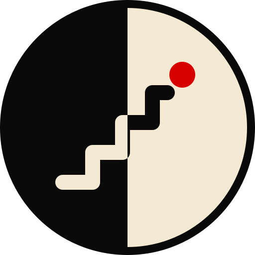
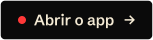
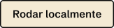

<a id="top"></a>

<div align="center">

<picture>
  <source media="(prefers-color-scheme: dark)" srcset="https://raw.githubusercontent.com/voaneves/altamente/main/assets/logo/logo-dark.svg" />
  <source media="(prefers-color-scheme: light)" srcset="https://raw.githubusercontent.com/voaneves/altamente/main/assets/logo/logo-light.svg" />
  
</picture>

<h1>Altamente</h1>

<p>
  <strong>Acompanha o desenvolvimento de crianças e conecta terapeutas, educadores e famílias.</strong><br />
  <sub>Rastreamento de habilidades para educação inclusiva, em React, TypeScript e Firebase</sub>
</p>

<p>
  <a href="https://voaneves.github.io/altamente/"><picture><source media="(prefers-color-scheme: dark)" srcset="https://raw.githubusercontent.com/voaneves/altamente/main/assets/buttons/live-dark.svg" /></picture></a>
  <a href="#como-rodar"><picture><source media="(prefers-color-scheme: dark)" srcset="https://raw.githubusercontent.com/voaneves/altamente/main/assets/buttons/run-dark.svg" /></picture></a>
</p>

<p><sub>Precisa de algo assim? <a href="https://voaneves.com/#contato"><strong>Vamos conversar →</strong></a></sub></p>

<p>
  <a href="https://github.com/voaneves/altamente/blob/main/LICENSE"></a>
  
</p>

<p>
  <a href="https://voaneves.github.io/altamente/">App</a> ·
  <a href="#funcionalidades">Funcionalidades</a> ·
  <a href="#como-rodar">Como rodar</a> ·
  <a href="#deploy">Deploy</a> ·
  <a href="#contato">Contato</a>
</p>

</div>

<picture>
  <source media="(prefers-color-scheme: dark)" srcset="https://raw.githubusercontent.com/voaneves/altamente/main/assets/brand/rule-dark.svg" />
  <source media="(prefers-color-scheme: light)" srcset="https://raw.githubusercontent.com/voaneves/altamente/main/assets/brand/rule-light.svg" />
  
</picture>

## Sobre o projeto

O Altamente ajuda terapeutas, educadores e famílias a acompanharem, dia a dia, o desenvolvimento de uma criança.

O app registra o nível de sucesso em habilidades como Interação Social, Foco e Atenção, Coordenação Motora, Comunicação Expressiva e Regulação Emocional. Profissionais e famílias veem painéis próprios, com relatórios de progresso gerados por IA e dados sincronizados em tempo real.

**App:** <https://voaneves.github.io/altamente/>

### Tecnologias

React, TypeScript, Tailwind CSS, Firebase (Firestore), Capacitor e Google Gemini. Foco em desempenho e em uso no celular (PWA).

## Funcionalidades

- **Rastreamento de habilidades:** registro diário do nível de sucesso em diversas atividades.
- **Painéis por papel:** visões e permissões diferentes para administradores (profissionais) e famílias.
- **Assistente com IA (Gemini):** relatórios de progresso e insights a partir do histórico da criança.
- **Tempo real:** o Firestore mantém as informações atualizadas em todos os dispositivos.
- **PWA:** instalável no celular ou no desktop.
- **Feedback tátil:** respostas físicas às interações, via Capacitor.

## Como rodar

```sh
git clone https://github.com/voaneves/altamente.git
cd altamente
npm install
```

Configure as variáveis de ambiente do Firebase e da API do Gemini no arquivo
`.env` (veja `.env.example`) e inicie o servidor de desenvolvimento:

```sh
npm run dev
```

## Deploy

O deploy usa GitHub Actions e publica no GitHub Pages:

1. Um *push* na branch `main` (ou `master`) aciona o workflow.
2. O workflow instala as dependências, gera o build otimizado e publica o resultado.
3. O app fica disponível em <https://voaneves.github.io/altamente/>.

## Contribuindo

Sugestões são bem-vindas: faça um fork, crie uma branch e abra um pull request, ou abra uma [issue](https://github.com/voaneves/altamente/issues) com a tag `enhancement`.

## Agradecimentos

[React](https://react.dev/), [Tailwind CSS](https://tailwindcss.com/), [Firebase](https://firebase.google.com/), [Google Gemini](https://gemini.google.com/), [Capacitor](https://capacitorjs.com/) e [Lucide Icons](https://lucide.dev/).

## Contato

<p>
  <a href="https://voaneves.com/#contato"><picture><source media="(prefers-color-scheme: dark)" srcset="https://raw.githubusercontent.com/voaneves/altamente/main/assets/buttons/hire-dark.svg" /></picture></a>
  <a href="https://voaneves.com/"><picture><source media="(prefers-color-scheme: dark)" srcset="https://raw.githubusercontent.com/voaneves/altamente/main/assets/buttons/site-dark.svg" /></picture></a>
</p>

<a href="https://linkedin.com/in/voaneves">LinkedIn</a> · <a href="mailto:victorneves478@gmail.com">E-mail</a>

<p align="center">
  
</p>

<p align="center"><sub>Distribuído sob a <a href="https://github.com/voaneves/altamente/blob/main/LICENSE">licença MIT</a>.</sub></p>

<p align="center"><sub><a href="#top">↑ Voltar ao topo</a></sub></p>
